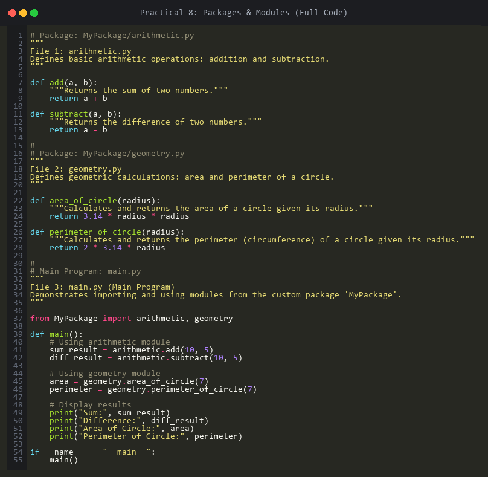
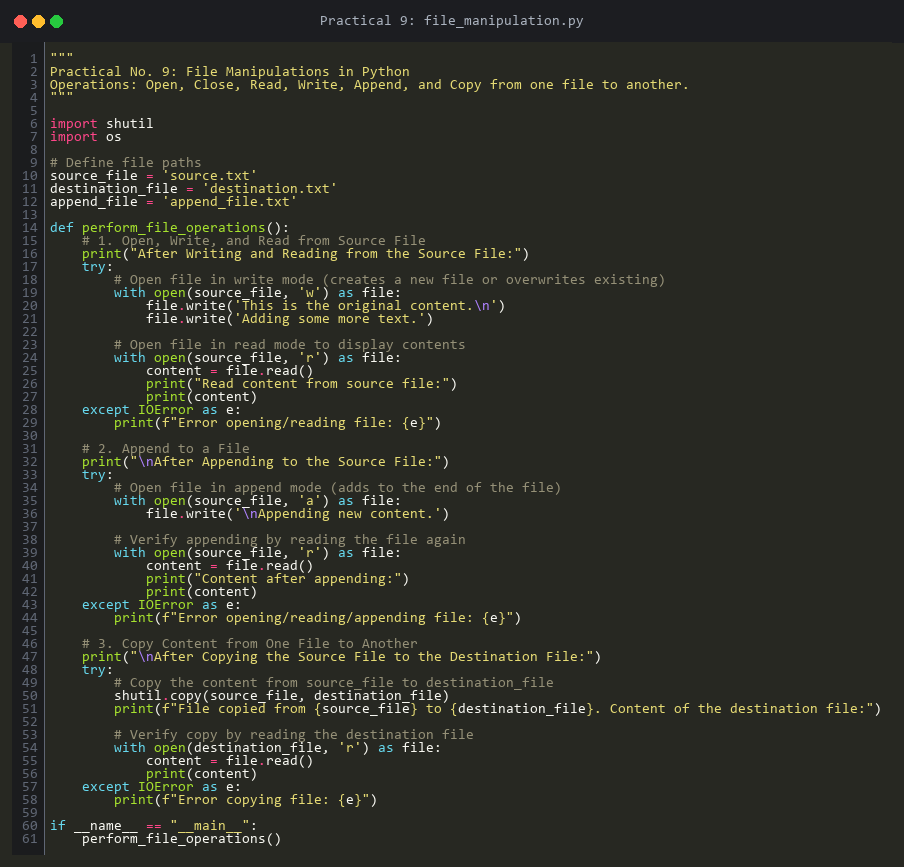
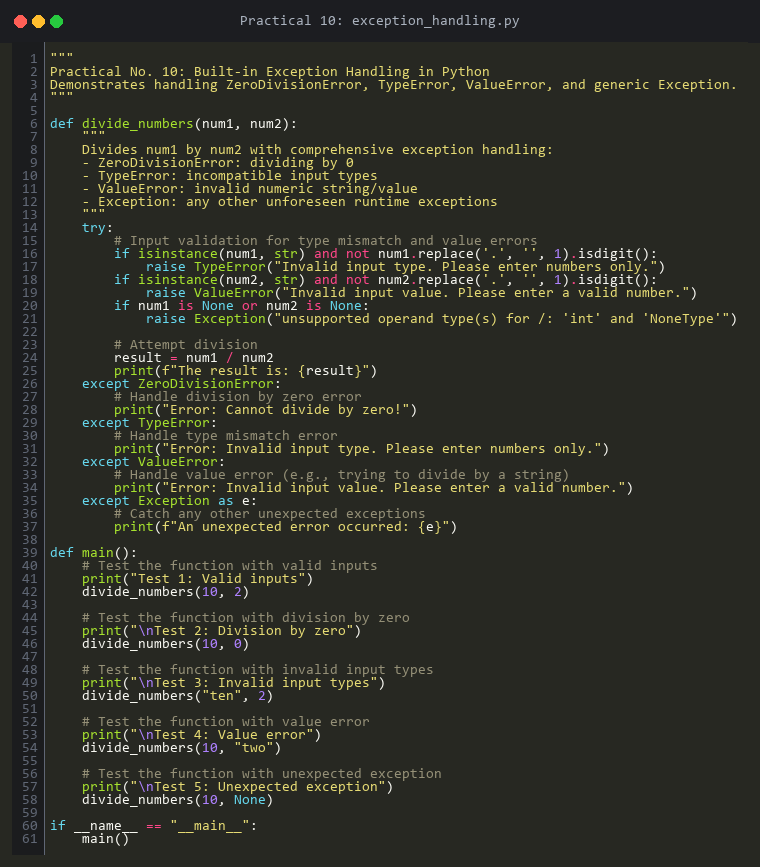

# Python Programming Lab Re-Performance (Major Defaulters Task)

**Institution:** Pimpri Chinchwad Education Trust's Pimpri Chinchwad University (PCU), Sate Maval, Pune  
**Record No.:** ACAD/R/26  
**School / Program / Department:** CSE - AI & ML  
**Semester:** III | **Division:** SY-A, B & C  
**Subject:** Python Programming  
**Category:** 21% – 50% Attendance (Major Defaulters)  
**Task 2:** Lab Re-performance — *Repeat any 3 Python lab experiments and upload the code and output to GitHub.*

---

## Selected Experiments
This repository contains the complete implementation, documented source code, verified output execution logs, code screenshot photos, and full answers to lab manual questions for the following **3 selected experiments**:

1. **[Practical No. 8: Creating Packages and Importing Modules](./Practical_08)**
2. **[Practical No. 9: File Manipulations (Open, Read, Write, Append, Copy)](./Practical_09)**
3. **[Practical No. 10: Built-in Exception Handling (Robust & Fault-Tolerant Code)](./Practical_10)**

---

## Repository Structure

```
├── README.md                                # Consolidated submission report
├── .gitignore                               # Git ignore configuration
│
├── Practical_08/
│   ├── MyPackage/
│   │   ├── __init__.py                      # Package indicator
│   │   ├── arithmetic.py                    # Addition and subtraction functions
│   │   └── geometry.py                      # Circle area and perimeter functions
│   ├── main.py                              # Main script importing and using MyPackage
│   ├── output.txt                           # Verified execution output
│   ├── code_screenshot.png                  # Photo of the complete code
│   ├── code_arithmetic.png                  # Photo of arithmetic module code
│   ├── code_geometry.png                    # Photo of geometry module code
│   ├── code_main.png                        # Photo of main program code
│   └── README.md                            # Documentation, screenshots & answers to questions
│
├── Practical_09/
│   ├── file_manipulation.py                 # File read, write, append, and copy operations
│   ├── source.txt                           # Source file generated by script
│   ├── destination.txt                      # Copied destination file
│   ├── output.txt                           # Verified execution output
│   ├── code_screenshot.png                  # Photo of the code
│   └── README.md                            # Documentation, screenshot & answers to questions
│
└── Practical_10/
    ├── exception_handling.py                # Handling ZeroDivisionError, TypeError, ValueError, Exception
    ├── output.txt                           # Verified execution output
    ├── code_screenshot.png                  # Photo of the code
    └── README.md                            # Documentation, screenshot & answers to questions
```

---

## Experiment Summaries, Code Photos & Execution

### 1. Practical No. 8 — Packages and Modules
- **Aim:** To write a Python program to create packages and import modules from packages to demonstrate the principles and practices of creating and using Python packages and modules.
- **Path:** [`Practical_08/main.py`](./Practical_08/main.py)
- **Photo of Code:**  
  
- **Execution Command:**
  ```bash
  cd Practical_08
  python main.py
  ```
- **Output:**
  ```text
  Sum: 15
  Difference: 5
  Area of Circle: 153.86
  Perimeter of Circle: 43.96
  ```

---

### 2. Practical No. 9 — File Manipulations
- **Aim:** To write a Python program to perform file manipulations — open, close, read, write, append, and copy from one file to another.
- **Path:** [`Practical_09/file_manipulation.py`](./Practical_09/file_manipulation.py)
- **Photo of Code:**  
  
- **Execution Command:**
  ```bash
  cd Practical_09
  python file_manipulation.py
  ```
- **Output:**
  ```text
  After Writing and Reading from the Source File:
  Read content from source file:
  This is the original content.
  Adding some more text.

  After Appending to the Source File:
  Content after appending:
  This is the original content.
  Adding some more text.
  Appending new content.

  After Copying the Source File to the Destination File:
  File copied from source.txt to destination.txt. Content of the destination file:
  This is the original content.
  Adding some more text.
  Appending new content.
  ```

---

### 3. Practical No. 10 — Exception Handling
- **Aim:** To write a Python program to handle exceptions using Python built-in exceptions and to write code that is robust, reliable, and fault-tolerant.
- **Path:** [`Practical_10/exception_handling.py`](./Practical_10/exception_handling.py)
- **Photo of Code:**  
  
- **Execution Command:**
  ```bash
  cd Practical_10
  python exception_handling.py
  ```
- **Output:**
  ```text
  Test 1: Valid inputs
  The result is: 5.0

  Test 2: Division by zero
  Error: Cannot divide by zero!

  Test 3: Invalid input types
  Error: Invalid input type. Please enter numbers only.

  Test 4: Value error
  Error: Invalid input value. Please enter a valid number.

  Test 5: Unexpected exception
  An unexpected error occurred: unsupported operand type(s) for /: 'int' and 'NoneType'
  ```

---

## Comprehensive Viva & Review Questions Solved

### Practical 8 Questions
1. **What is a module in Python?**  
   *Answer:* A file containing Python code (functions, classes, variables) with a `.py` extension that can be imported into other scripts.
2. **What is the purpose of the `__init__.py` file in a package?**  
   *Answer:* It tells Python that the directory containing it should be treated as a package namespace.
3. **How do you import a specific function from a module?**  
   *Answer:* Using `from module_name import function_name`.
4. **What are the advantages of using packages in Python programming?**  
   *Answer:* Modularity, namespace collision prevention, easier debugging, and high code reusability.
5. **Write the directory structure for a package containing three modules named maths, string_ops, and file_ops:**  
   ```
   my_package/
   ├── __init__.py
   ├── maths.py
   ├── string_ops.py
   └── file_ops.py
   ```

### Practical 9 Questions
1. **How do you read a CSV file into a Python list?**  
   *Answer:* Using `list(csv.reader(file))`.
2. **How do you write a list of lists to a CSV file in Python?**  
   *Answer:* Using `csv.writer(file).writerows(data)`.
3. **How do you read a CSV file into a dictionary in Python?**  
   *Answer:* Using `csv.DictReader(file)`.
4. **How do you append a row to an existing CSV file?**  
   *Answer:* Open file in `'a'` mode and call `csv.writer(file).writerow(row_data)`.
5. **How can you skip the header row while reading a CSV file?**  
   *Answer:* Call `next(reader)` before reading the rest of the rows.

### Practical 10 Questions
1. **What exception is raised when you try to access an index that is out of range in a list?**  
   *Answer:* `IndexError`.
2. **What exception is raised when you try to convert a string that cannot be converted to an integer using `int()`?**  
   *Answer:* `ValueError`.
3. **Python function `convert_to_int(s)` handling `ValueError`:**  
   ```python
   def convert_to_int(s):
       try:
           return int(s)
       except ValueError:
           return "Error: Invalid input!"
   ```
4. **How do you create a custom exception in Python?**  
   *Answer:* By subclassing the built-in `Exception` class:
   ```python
   class CustomError(Exception):
       pass
   ```
5. **Python function `find_index(lst, elem)` handling `ValueError`:**  
   ```python
   def find_index(lst, elem):
       try:
           return lst.index(elem)
       except ValueError:
           return "Error: Element not found!"
   ```

---

## Instructions to Push to GitHub

1. Initialize or configure your git repository:
   ```bash
   git add .
   git commit -m "Add Python Lab Re-performance code, outputs, and screenshots for Practical 8, 9, and 10"
   ```
2. Link your remote repository and push:
   ```bash
   git branch -M main
   git remote add origin https://github.com/<your-username>/<your-repo-name>.git
   git push -u origin main
   ```
